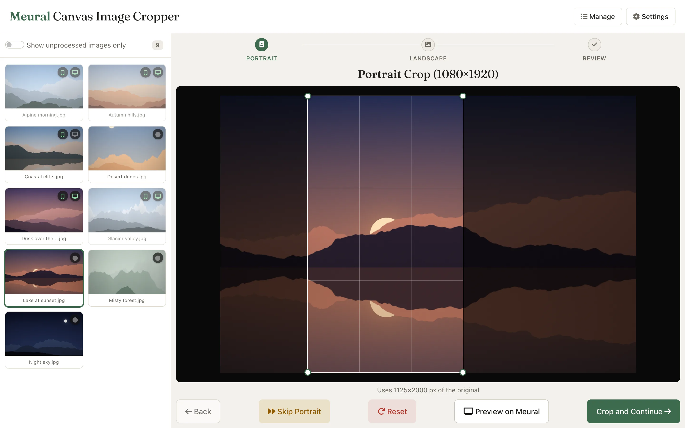
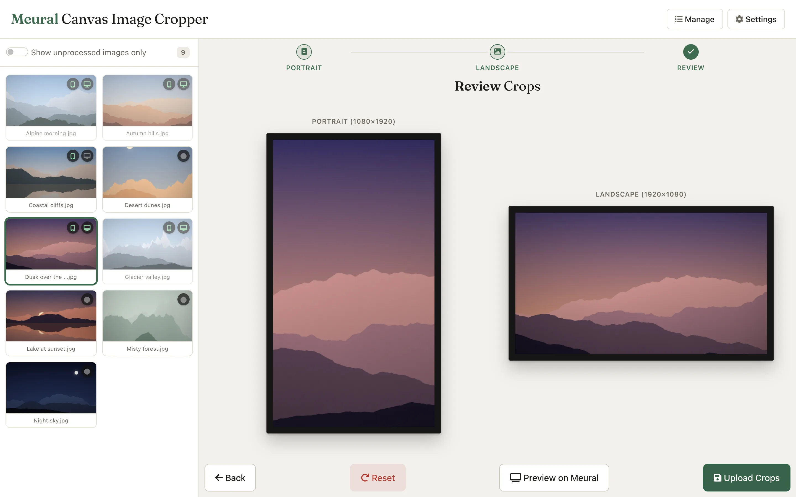
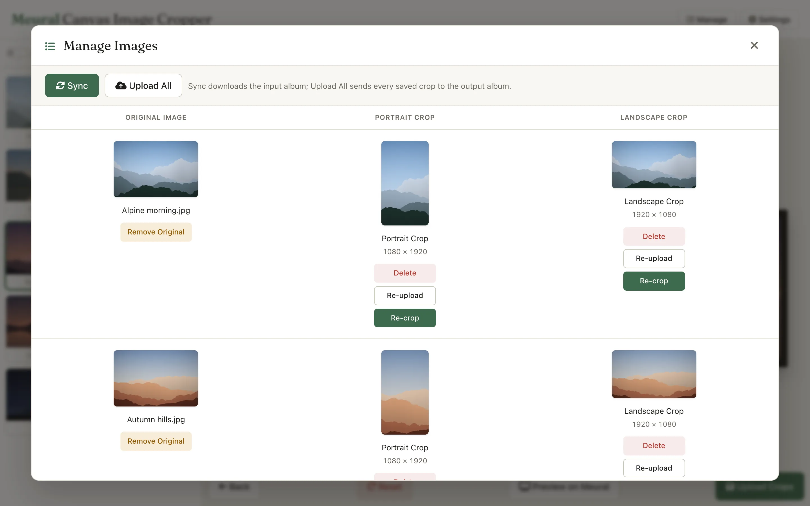
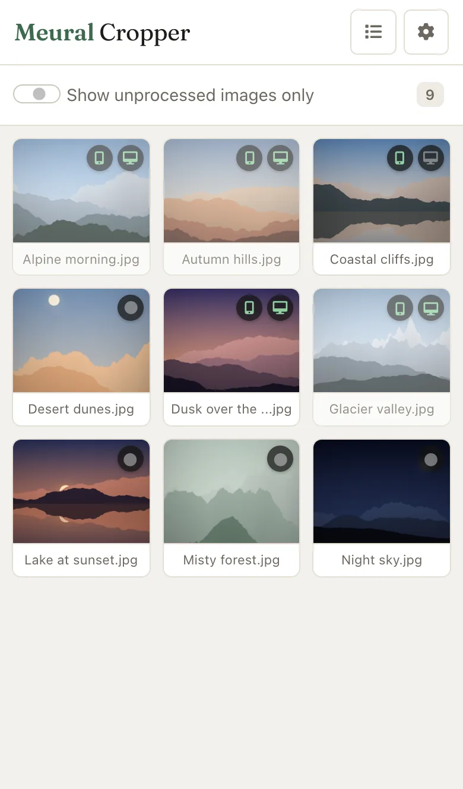
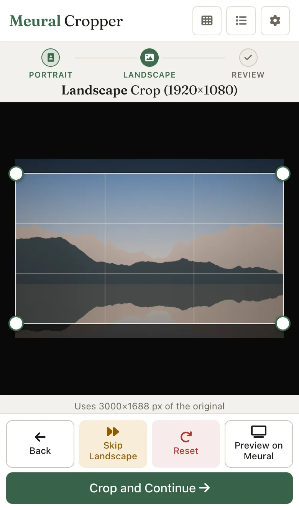

# Immich-MeuralCanvas-Cropper

A comprehensive web application designed to seamlessly crop images from Immich for optimal display on Meural Canvas digital frames. This tool provides an intuitive interface for creating perfectly sized portrait (1080×1920) and landscape (1920×1080) crops that maintain aspect ratios and image quality.

<p align="center">
<picture>
  <source media="(prefers-color-scheme: dark)" srcset="docs/screenshots/editor-dark.webp">
  
</picture>
</p>

## 📋 Table of Contents

- [Features](#features)
- [Screenshots](#screenshots)
- [Prerequisites](#prerequisites)
- [Installation](#installation)
- [Configuration](#configuration)
- [Usage](#usage)
- [Storage & Data Persistence](#storage--data-persistence)
- [API Endpoints](#api-endpoints)
- [Development](#development)
- [Troubleshooting](#troubleshooting)
- [Contributing](#contributing)

## ✨ Features

### Core Functionality
- **Interactive Crop Editor**: Visual crop rectangle with drag-and-resize handles
- **Dual Orientation Support**: Create both portrait (1080×1920) and landscape (1920×1080) crops
- **Aspect Ratio Preservation**: Automatic maintenance of correct aspect ratios
- **Real-time Preview**: Live preview of crop areas with overlay visualization
- **Saved Crop Data**: Persistent storage of crop coordinates for each image

### Immich Integration
- **Direct Album Access**: Connect to specific Immich albums for input and output
- **Metadata Preservation**: Maintains EXIF data and image quality
- **Batch Processing**: Process multiple images efficiently
- **Asset ID Mapping**: Seamless integration with Immich's asset management

### Meural Canvas Integration
- **Live Preview**: Send crops directly to Meural Canvas for preview
- **Multi-Device Support**: Configure multiple Meural Canvas devices
- **Automatic Upload**: Batch upload completed crops to Meural Canvas

### User Interface
- **Responsive Design**: Works on desktop, tablet, and mobile devices, with a touch-friendly phone layout
- **Light and Dark Themes**: Follows your system setting
- **Landing Page**: Welcome screen when no image is selected
- **Progress Tracking**: Visual indicators for processing status
- **Error Handling**: Comprehensive error messages and recovery

## 📸 Screenshots

<p align="center">
<picture>
  <source media="(prefers-color-scheme: dark)" srcset="docs/screenshots/review-dark.webp">
  
</picture>
<picture>
  <source media="(prefers-color-scheme: dark)" srcset="docs/screenshots/manage-dark.webp">
  
</picture>
</p>
<p align="center"><sub>Review both crops before uploading &nbsp;·&nbsp; Manage, re-crop or re-upload anything you've processed</sub></p>

<p align="center">
<picture>
  <source media="(prefers-color-scheme: dark)" srcset="docs/screenshots/phone-library-dark.webp">
  
</picture>
&nbsp;&nbsp;
<picture>
  <source media="(prefers-color-scheme: dark)" srcset="docs/screenshots/phone-editor-dark.webp">
  
</picture>
</p>
<p align="center"><sub>On a phone the library and the editor each take the full screen. Light and dark themes follow your system setting.</sub></p>

## 🔧 Prerequisites

- **Python 3.11+**
- **Immich Server**: Running instance with API access
- **Meural Canvas**: One or more Meural Canvas devices (optional)
- **Network Access**: Connectivity to Immich server and Meural devices

## 🚀 Installation

### Docker (Recommended)

A ready-made image is published for every change to `main`:
`ghcr.io/mikefez/immich-meuralcanvas-cropper:latest` (also tagged `main`, and
`sha-<commit>` to pin an exact version). There's nothing to clone or build.

1. **Create the config directory** (the app saves its settings, crops and image
   cache there):
   ```bash
   mkdir -p config
   ```

2. **Run it**, with Docker Compose (`docker-compose.yml`):
   ```yaml
   services:
     meural-cropper:
       image: ghcr.io/mikefez/immich-meuralcanvas-cropper:latest
       container_name: meural-cropper
       ports:
         - "5001:5000"
       volumes:
         - ./config:/config
       environment:
         - PUID=1000   # owner of ./config on the host (`id -u`)
         - PGID=1000   # `id -g`
       restart: unless-stopped
       # The image has a built-in HEALTHCHECK against /health.
   ```
   ```bash
   docker compose up -d
   ```

   or with Docker directly:
   ```bash
   docker run -d -p 5001:5000 \
     -v "$(pwd)/config:/config" \
     -e PUID=$(id -u) -e PGID=$(id -g) \
     --restart unless-stopped \
     --name meural-cropper \
     ghcr.io/mikefez/immich-meuralcanvas-cropper:latest
   ```

3. **Open http://localhost:5001**. Settings opens on first start; see
   [Configuration](#configuration).

To update: `docker compose pull && docker compose up -d` (or pull the image and
recreate the container).

### Building from source

```bash
git clone https://github.com/MikeFez/Immich-MeuralCanvas-Cropper.git
cd Immich-MeuralCanvas-Cropper
mkdir -p config

make run    # build and run on port 5001
make dev    # with live code reloading (mounts ./app)
make logs   # follow the logs
make stop   # stop the container
```

Without Make: `docker build -t meural-cropper .`, then run it as above with
`meural-cropper` as the image. For live reloading, add `-v "$(pwd)/app:/app"
-e FLASK_DEBUG=1`.

### Manual Installation

1. **Clone and setup**:
   ```bash
   git clone https://github.com/MikeFez/Immich-MeuralCanvas-Cropper.git
   cd Immich-MeuralCanvas-Cropper
   python -m venv venv
   source venv/bin/activate  # On Windows: venv\Scripts\activate
   ```

2. **Install dependencies**:
   ```bash
   pip install -r requirements.txt
   ```

3. **Create the config directory**:
   ```bash
   mkdir -p config
   ```
   Settings opens on first start (see [Configuration](#configuration)).

4. **Run application**:
   ```bash
   cd app
   python app.py
   ```

The application will be available at `http://localhost:5000`.

Local runs use the repository's `config/` directory; Docker uses `/config`.
Everything lives in that one directory:

| Path | Contents |
|------|----------|
| `config.yaml` | Your configuration |
| `crops/metadata.json` | Crop coordinates, upload records and unfinished upload checkpoints |
| `jobs.json` | The ten most recent background jobs, including errors and unfinished images |
| `cache/` | Downloaded sources, thumbnails and rendered previews/crops. Disposable: Sync restores sources, and previews rebuild on demand. Keeping it avoids re-downloading originals after the container is recreated. |

Set `CONFIG_DIR` to move the whole directory, or `CACHE_DIR` (formerly
`APP_TMP_DIR`) to keep the cache elsewhere, e.g. if you back up `/config` and
don't want the images in the backup. Images sync in the background on startup
and then on the Settings interval, so an unavailable Immich server does not
block the UI; the Sync and Upload All buttons (in Manage) show progress and can
be used to retry.

The container runs the app as `PUID:PGID` (default `1000:1000`), not root, and
takes ownership of `/config` on startup so files stay editable from the host.
Set them to the host owner of your config directory. It serves with Waitress,
a production WSGI server, in a single process (the per-image locks and
background jobs live in memory, so don't run multiple workers).

## ⚙️ Configuration

Open **Settings** (top right). On first start it opens by itself.

1. Enter the Immich server URL and an API key (see [below](#getting-immich-api-key)
   for the permissions it needs).
2. Click **Connect & load albums**, then choose the **input album** (photos to
   crop) and the **output album** (where crops go). Albums shared with you are
   listed too; the two must be different. **Sync every** sets how often the
   input album is checked for new and changed photos (default 15 minutes; 0
   turns it off). Open pages pick up the changes by themselves.
3. Add your Meural Canvas devices (optional) and set the crop sizes to your
   Canvas's resolution.
4. **Save**. Settings take effect immediately, without a restart, and choosing
   a different input album starts a sync.

Settings are saved to `config/config.yaml` (`/config/config.yaml` in Docker),
readable only by the app's user. The API key is never sent back to the browser:
its field shows "Saved", and leaving it blank keeps it. **Changing the server
URL requires entering the key again**, so the saved key can't be sent to a
different server. The app has no login, so anyone who can reach it can change
settings, but not read the key.

Changing a crop size doesn't change crops already saved; they're padded with
black bars until you re-crop them, and the app asks before saving such a change.
Every crop then counts as not uploaded, since Immich has it at the old size.

You can also write `config.yaml` by hand, based on `config-example.yaml`. Saving
from Settings rewrites the file, dropping any comments:

```yaml
# Image dimensions for Meural Canvas
dimensions:
  portrait_size: [1080, 1920]   # Width x Height
  landscape_size: [1920, 1080]  # Width x Height

# Immich server configuration
immich:
  url: "http://your-immich-server:2283"
  api_key: "your-immich-api-key"
  input_album_id: "album-id-for-source-images"
  output_album_id: "album-id-for-cropped-images"

# Meural Canvas devices (optional)
meural:
  devices:
    - name: "Living Room Canvas"
      ip: "192.168.1.136"
      preview_duration: 10  # seconds
    - name: "Bedroom Canvas"
      ip: "192.168.1.137"
      preview_duration: 15

# How often to sync the input album, in minutes (0 = off)
sync:
  interval_minutes: 15
```

### Getting Immich API Key
1. Log into your Immich web interface
2. Go to Account Settings → API Keys
3. Create a new API key with only the permissions below
4. Paste it into Settings. It is stored in `config/config.yaml`, which git ignores; never commit it

| Permission | Used for |
|------------|----------|
| `album.read` | Read the input and output albums |
| `asset.read` | List the albums' photos (Immich v3 search) and read each one's details |
| `asset.download` | Download originals into the cache |
| `asset.upload` | Upload the rendered crops |
| `albumAsset.create` | Add crops to the output album |
| `albumAsset.delete` | Remove an image from the input album (Manage → Remove Original) |
| `asset.delete` | Move the previous crop to the Immich trash when re-uploading |

`asset.update` isn't needed: re-uploading a crop uploads a new asset and trashes
the old one, since Immich v3 removed in-place replacement. Nothing is ever
permanently deleted. Without `asset.delete`, re-uploads fail after uploading the
new crop, leaving the old one in the output album.

Permissions can't be limited to specific albums, so the key can read and trash
any asset its user owns. For tighter isolation, create a dedicated Immich user
for the cropper and share the input and output albums with it.

### Finding Album IDs
Settings lists your albums by name, so you only need IDs when editing
`config.yaml` by hand: open the album in Immich and copy the ID from the URL
(`/albums/{album-id}`).

## 📖 Usage

### Basic Workflow

1. **Access the Application**
   - Open `http://localhost:5001` in your browser
   - You'll see the landing page with image selection sidebar

2. **Select an Image**
   - Browse images from the configured Immich album. Only images that still
     need work are listed at first; turn off "Show unprocessed images only" to
     see them all (your choice is remembered in this browser)
   - Click on any image to start cropping
   - Previously cropped images show status indicators

3. **Create Portrait Crop**
   - Adjust the crop rectangle by dragging corners or edges
   - The aspect ratio is automatically maintained at 9:16
   - Below the image, the app shows how many of the original's pixels the crop
     uses, and warns when the crop is smaller than the output size and will be
     enlarged (it may look soft on the Canvas)
   - Click "Crop and Continue" to save the portrait crop

4. **Create Landscape Crop**
   - The interface switches to landscape mode (16:9 aspect ratio)
   - Adjust the crop area for the landscape orientation
   - Click "Crop and Continue" to save the landscape crop

5. **Review and Upload**
   - Preview both crops in the final review stage
   - Use "Preview on Meural" to test on your canvas devices
   - Click "Upload Crops" to save to Immich output album (crops already in
     Immich unchanged aren't sent again)

### Advanced Features

#### Keyboard Shortcuts
- **Arrow Keys**: Fine-tune crop position
- **Shift + Arrow**: Resize crop rectangle
- **Enter**: Proceed to next stage
- **Escape**: Cancel current operation

#### Batch Operations
- Open Manage (top right) for Sync, which downloads new and changed photos from the input album, and Upload All, which renders and uploads every crop that is new or changed since its last upload (or was uploaded at a different size). Manage's Re-upload sends one crop again regardless
- Filter view to show only unprocessed images; the count beside the switch shows how many are listed
- Progress shows on the Sync and Upload All buttons, and the Manage icon spins while either runs
   - Review, Meural previews and uploads share the same rendered JPEG cache

#### Background Activity and Recovery
Manage includes **Recent activity**, with counts, elapsed time and per-image
errors for Sync and Upload All. **Cancel** stops new images from starting;
in-flight downloads or uploads finish first, and completed work is kept.
**Retry failed** processes only failed images. Cancelled jobs and jobs
interrupted by a restart offer **Retry unfinished**, which also includes images
that had not started. If a job failed before it could list its images, retry
repeats album discovery. Retries use current saved crop selections. After
changing Immich server or album settings, start a new job instead of retrying
an old one.

Upload checkpoints are saved after the image reaches Immich, after it is added
to the output album, and after the previous version is trashed. A retry resumes
the unfinished step using the saved remote ID. If the crop changed in the
meantime, the previous upload is finished before the new selection is sent.
An unfinished upload must be completed against its original server and output
album. As with any remote operation, a connection loss or crash between Immich
accepting an upload and saving its ID locally can require sending the same
bytes again; Immich's duplicate detection handles identical uploads.

#### Quality Settings
The application preserves image quality through:
- LANCZOS resampling for high-quality resizing
- One EXIF-orientation-aware renderer for editor crops, Meural previews, and uploads
- Original EXIF dates, camera/GPS metadata, and ICC color profiles are retained;
  orientation and pixel dimensions are corrected and stale embedded thumbnails removed
- JPEG quality 95 with 4:4:4 chroma sampling

The sidebar uses cached thumbnails up to 320 pixels, with stable versioned URLs
and conditional HTTP requests. The editor loads an upright JPEG up to 2048
pixels on its longest edge, while all selections and resolution warnings use
the original's dimensions. Full-resolution sources remain on the server for
final rendering.
Sync repairs missing or corrupt cached images and removes local entries that
leave the source album. Saved crop coordinates remain available if an image is
added back later. A failed album fetch never triggers cache removal.

## 💾 Storage & Data Persistence

### Crop Data Storage
All persistent state lives in one file, **`/config/crops/metadata.json`**:

```json
{
  "crops": {
    "<immich-asset-id>": {
      "portrait": {
        "crop": { "x": 720, "y": 100, "width": 863, "height": 1537 },
        "uploaded": {
          "asset_id": "<uploaded-immich-asset-id>",
          "crop": { "x": 720, "y": 100, "width": 863, "height": 1537 },
          "at": "2026-10-17T19:52:38+00:00"
        }
      },
      "landscape": {
        "crop": { "x": 0, "y": 120, "width": 2305, "height": 1296 }
      }
    }
  }
}
```

- `crop` is the saved selection in upright source-image pixels.
- `uploaded` records the selection that was last uploaded to Immich. An image is
  **completed** when every saved selection matches its upload record, so
  re-cropping after an upload marks the image as pending again.
- Deleting a crop keeps its upload record so a later upload still replaces the
  previous copy.
- Older installs that used `progress.json` and bare coordinates are migrated
  automatically on startup; the old file is renamed to `progress.json.migrated`.

### On-Demand Image Generation

Rendered crops and editor previews are cached as disposable JPEGs in
`cache/renders/`. Their keys include the source version, crop coordinates,
output dimensions, metadata setting and renderer version. Review, Meural
postcards and uploads reuse the same crop bytes, so what you preview is exactly
what gets uploaded. Conditional HTTP requests avoid downloading unchanged
previews again. The render cache is limited to 512 MiB; oldest entries are
evicted first, and entries unused for 30 days are removed when new renders are
cached. Deleting the cache is safe: missing renders are recreated on demand.

Immich API requests and source downloads reuse HTTP connections within each
worker thread. Meural requests use separate pooled sessions. Sessions are
isolated between threads and integrations, and reset when settings are applied.
Uploads are not automatically retried by the HTTP transport.

Re-uploading a crop uploads a new version to the output album, then moves the
previous version to the Immich trash. This avoids the in-place replacement
endpoint, which was removed in Immich v3. If Immich reports the new upload as a
duplicate of the existing one, the existing copy is kept.

### Data Management
Only the configuration directory needs to persist across container updates;
the source-image and thumbnail cache in `/config/cache` is rebuilt by Sync if lost:
```bash
docker run -v /host/path/config:/config ...
```

## 🔌 API Endpoints

Images are always identified by their Immich asset ID (a UUID). Mutating
endpoints take `{"identifier": "<asset-id>", ...}` and respond with the updated
`image` record; errors are JSON `{"success": false, "error": "..."}`.

### Images
- `GET /images`: cached source images with `crops` and `status`
- `GET /image/{asset_id}`: source image
- `GET /editor-image/{asset_id}`: cached upright editor preview, up to 2048px
- `GET /thumbnail/{asset_id}`: 320px thumbnail
- `GET /output/{orientation}/{asset_id}`: saved crop rendered at frame size
- `POST /crop`: save a crop (`orientation`, `crop`)
- `DELETE /crop-data/{asset_id}/{orientation}`: delete one saved crop
- `POST /reset`: delete both saved crops

### Immich
- `POST /sync`: start syncing the input album into the local cache (background job)
- `POST /complete`: upload an image's saved crops that aren't already in Immich
- `POST /upload-single`: upload one orientation (`orientation`)
- `POST /upload-all`: start uploading every new or changed crop (background job)
- `GET /settings`: current settings, without the API key (`has_api_key` instead), and `configured`
- `PUT /settings`: validate, save and apply settings; a blank `immich.api_key` keeps the saved key for the saved URL
- `POST /settings/albums`: list albums for a `url` and `api_key` before saving (same blank-key rule)
- `GET /jobs`: the running job, if any, and `last_sync`, the ID of the last completed sync
  (the UI polls this to refresh after scheduled syncs)
- `GET /jobs/{id}`: job status and progress (`status`, `done`, `total`, `result`, `error`).
  Starting a job while another runs returns 409 with the running job.
- `GET /jobs` also includes recent `history`; jobs include `elapsed_seconds`,
  per-image `errors`, `remaining_assets` and `cancel_requested`. A job that was
  running when the app restarted has status `interrupted`.
- `POST /jobs/{id}/cancel`: request cancellation after in-flight images finish
- `POST /jobs/{id}/retry`: start a new job for failed or unfinished images
- `DELETE /delete-original`: remove an image from the input album (the photo stays in the library)

### Meural
- `GET /meural/devices`: configured devices
- `POST /meural/preview`: send a crop to a device (`orientation`, `device_ip`, optional `use_temp` + `crop`)

### System
- `GET /dimensions`: configured frame sizes
- `GET /health`: health check

## 🛠️ Development

### Project Structure
```
├── app/
│   ├── app.py                 # Main Flask application
│   ├── config.py             # Configuration management
│   ├── static/               # Frontend assets
│   │   ├── js/              # JavaScript modules
│   │   └── styles.css       # Application styles
│   ├── templates/           # HTML templates
│   └── utils/               # Backend utilities
│       ├── immich_handler.py    # Immich API integration
│       ├── image_processor.py   # Image processing logic
│       ├── meural_handler.py    # Meural Canvas integration
│       └── file_handler.py     # File system operations
├── config/                  # Configuration files
└── Dockerfile              # Container configuration
```

### Frontend Architecture
- **Modular JavaScript**: Separate modules for different concerns
- **State Management**: Centralized application state
- **Responsive UI**: CSS Grid and Flexbox layouts
- **Error Handling**: Comprehensive error boundaries

### Backend Architecture
- **Flask Framework**: Lightweight web framework optimized for self-hosted deployments
- **Modular Design**: Separate handlers for different integrations
- **Error Recovery**: Graceful handling of network failures
- **Logging**: Comprehensive request and error logging

### Running in Development
```bash
# Install development dependencies
pip install -r requirements.txt

# Debug mode uses Flask's auto-reloading dev server instead of Waitress
export FLASK_DEBUG=1

# Run with auto-reload
cd app
python app.py
```

## 🔧 Troubleshooting

### Common Issues

#### Connection to Immich Failed
- Verify Immich URL and API key in config
- Check network connectivity to Immich server
- Ensure API key has proper permissions

#### Images Not Loading
- Confirm input album ID is correct
- Check Immich album contains accessible images
- Verify image file formats are supported

#### Meural Preview Not Working
- Confirm Meural Canvas IP addresses
- Check network connectivity to Meural devices
- Verify devices are powered on and connected

#### Crop Rectangle Issues
- Refresh the page to reset crop state
- Check browser console for JavaScript errors
- Ensure images are fully loaded before cropping

### Log Analysis
Check application logs for detailed error information:
```bash
# Docker logs
docker logs <container-name>

# Manual installation
tail -f /path/to/app/logs/application.log
```

### Performance Optimization
- Use SSD storage for image processing
- Ensure adequate RAM for large images
- Consider image size limits for very large files
- Flask's threaded mode handles multiple concurrent requests efficiently
- Optimized for small-scale self-hosted deployments

## 🤝 Contributing

### Development Setup
1. Fork the repository
2. Create a feature branch
3. Make your changes
4. Add tests if applicable
5. Submit a pull request

### Code Style
- Follow PEP 8 for Python code
- Use ESLint for JavaScript
- Include docstrings for all functions
- Add comments for complex logic

### Testing

Backend regressions use synthetic images, a temporary configuration, and mocked
Immich responses. Install `requirements.txt`, then run:

```bash
python -m unittest discover -s tests -v
```

For browser checks, install the locked dependencies (`npm ci`) and
Google Chrome. Start the isolated fixture server in one terminal, then run the
browser checks in another:

```bash
python tests/serve_fixture.py
npm run test:browser
```

Set `PLAYWRIGHT_MODULE` to reuse an existing Playwright installation. Browser
checks use `http://127.0.0.1:5087` and never contact your Immich server.

CI runs backend, JavaScript syntax, and Chromium browser checks on pushes and
pull requests. Publishing the Docker image from `main` requires those checks
to pass. Browser dependencies are for testing only and are not included in the
runtime image.

## 📄 License

This project is licensed under the MIT License - see the LICENSE file for details.

## 🙏 Acknowledgments

- Immich team for the excellent photo management platform
- Meural for creating beautiful digital canvas devices
- Contributors and users of this project

---

For additional support, please open an issue on the project repository or check the troubleshooting section above.
